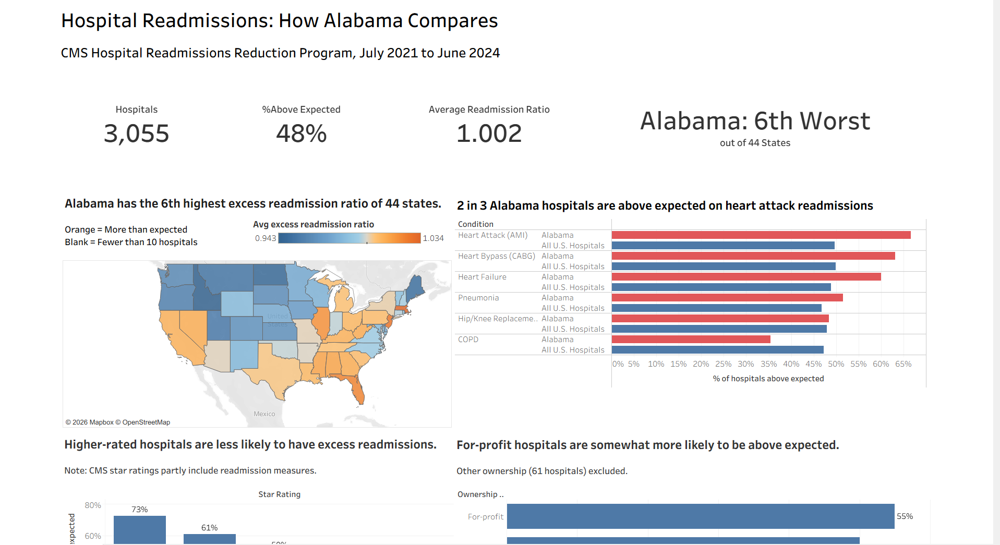
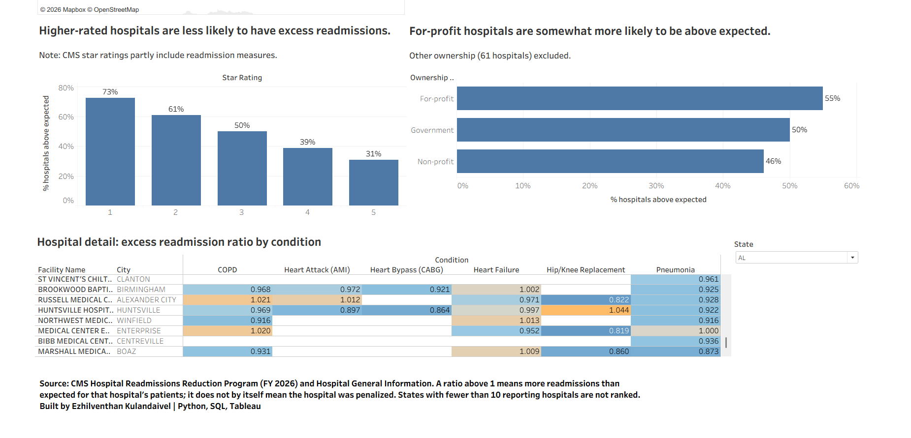

# Hospital Readmissions: How Alabama Compares

**[View the interactive dashboard on Tableau Public](https://public.tableau.com:9443/views/Healthcare_Project_17946689040880/HospitalReadmissions?:language=en-US&:sid=&:redirect=auth&:display_count=n&:origin=viz_share_link)**



## The question

Medicare penalizes hospitals that readmit more patients within 30 days than expected, given how sick their patients are. Using public CMS data on 3,055 U.S. hospitals, I looked at where hospitals fall short, and how Alabama compares with the rest of the country.

## Key findings

- **Alabama ranks 6th worst out of 44 states** for excess readmissions (states with at least 10 reporting hospitals).
- **Alabama trails the nation on 5 of 6 conditions.** The clearest gap is heart attack: 2 in 3 Alabama hospitals (66.7%) have more readmissions than expected, compared with about half nationally (49.7%).
- **COPD is Alabama's bright spot.** Only 35.4% of Alabama hospitals are above expected, versus 47.2% nationally.
- **Higher-rated hospitals do better.** 72.5% of 1-star hospitals are above expected, compared with 30.7% of 5-star hospitals. Readmissions are one input to the CMS star rating, so part of this relationship is built in.
- **For-profit hospitals are somewhat more likely to be above expected** than non-profits (54.9% vs. 46.1%). This is an association, not evidence that ownership causes the difference.

## Data

| Source | Description |
|---|---|
| [CMS Hospital Readmissions Reduction Program, FY 2026](https://data.cms.gov/provider-data/) | Readmission measures for 6 conditions per hospital, July 2021 to June 2024 |
| [CMS Hospital General Information](https://data.cms.gov/provider-data/) | Location, ownership, hospital type, and star rating |

Both datasets are public and are reported at the hospital level. They contain no patient-level data.

**Key measure: the excess readmission ratio.** CMS divides a hospital's predicted readmission rate by the rate an average hospital would have with the same patients. Above 1 means more readmissions than expected; below 1 means fewer.

## How I built it

```
CMS CSV files  ->  Python (load + clean)  ->  SQLite  ->  SQL analysis  ->  Tableau dashboard
```

1. **Load and profile** (`load_data.py`): loaded both files into SQLite and checked row counts, columns, and missing values.
2. **Clean and join** (`clean_data.py`):
   - Converted CMS placeholder text ("Too Few to Report", "Not Available") into real missing values
   - Kept hospital IDs as text so leading zeros (for example, `010001`) were not lost
   - Added readable condition names and simplified ownership into four groups
   - Joined the two files on Facility ID and validated the result (ratio = predicted / expected for every row)
3. **Analyze in SQL** (`queries.sql`): answered the business questions using:
   - `GROUP BY`, `HAVING`, and minimum sample sizes
   - CTEs and `LEFT JOIN` (Alabama vs. national comparison)
   - Window functions: `RANK()` for state rankings, `ROW_NUMBER() ... PARTITION BY` for each hospital's worst condition
4. **Visualize** in Tableau: KPI cards, a state map, condition, star rating and ownership comparisons, and a hospital-level table filterable by state.

## Limitations

- **Hospital-level data only.** It shows *where* readmissions are high, not *why* individual patients are readmitted.
- **Missing values.** About 36% of hospital-condition rows had too few patients for CMS to report a ratio. These were excluded, not treated as zero.
- **A ratio above 1 is not the same as being penalized.** The actual payment penalty uses a separate CMS formula with peer grouping.
- **Small numbers for some comparisons.** Some Alabama conditions have fewer than 30 reporting hospitals (19 for heart bypass), so those differences may partly reflect chance. I did not run significance tests.
- **Association, not causation.** Differences by ownership or star rating do not show what causes them.

## How to run it

```bash
pip install -r requirements.txt

python load_data.py      # load raw CSVs into data/hospital.db
python clean_data.py     # clean, join, and validate
python run_queries.py    # run every query in queries.sql, save results to outputs/
```

## Repository structure

```
hospital-readmissions-analysis/
├── data/
│   ├── raw/            # original CMS files (unchanged)
│   └── processed/      # cleaned files created by clean_data.py
├── outputs/            # query results (CSV)
├── images/             # dashboard screenshot
├── load_data.py
├── clean_data.py
├── queries.sql
├── run_queries.py
├── requirements.txt
└── README.md
```

## Next step

This project looks at hospitals. The next one goes to the patient level: predicting ICU outcomes using de-identified records from MIMIC-IV.

---

**Ezhilventhan Kulandaivel** · MS Data Science, University of Alabama at Birmingham
[LinkedIn](https://www.linkedin.com/in/ezhilventhan1410/) · [Portfolio](https://github.com/ezhil-14/ek-portfolio)
